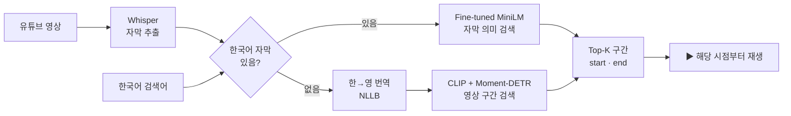
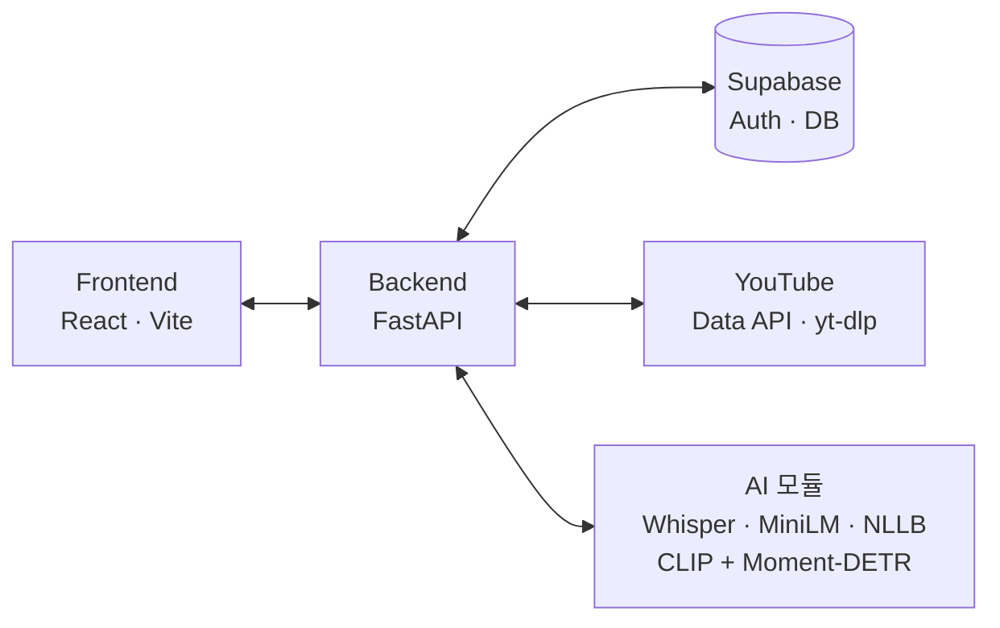

<div align="center">

# 📍 PinPoint

**검색어 한 줄로, 영상 속 그 장면까지**

자연어로 원하는 장면을 검색하면 유튜브 영상 속 관련 구간을 찾아<br>
타임스탬프와 함께 보여주고, 클릭하면 그 시점부터 바로 재생하는 웹 서비스


융합 캡스톤 디자인 · TEAM 핀포인트

</div>

<!-- 시연 GIF나 스크린샷을 여기에 넣으세요 -->
<!--  -->

---

## 목차

- [소개](#소개)
- [주요 기능](#주요-기능)
- [동작 방식](#동작-방식)
- [AI 모델과 성능](#ai-모델과-성능)
- [시스템 구조](#시스템-구조)
- [기술 스택](#기술-스택)
- [폴더 구조](#폴더-구조)
- [시작하기](#시작하기)
- [API](#api)
- [팀원](#팀원)

---

## 소개

유튜브 검색은 **영상 단위**로 결과를 보여줍니다. 원하는 장면은 결국 영상을 넘겨보며 직접 찾아야 합니다.

PinPoint는 **장면 단위**까지 찾아줍니다.

```
"두부를 끓는 물에 데치는 장면"  →  두부 요리 영상 · 00:36 ~ 00:40  →  ▶ 그 시점부터 재생
```

---

## 주요 기능

| 기능 | 설명 |
|---|---|
| 🔍 **다중 영상 검색** | 검색어 한 번으로 유튜브 상위 20개 영상의 구간을 한꺼번에 조회 |
| 💬 **자막 우선 분석** | 한국어 자막이 있으면 자막 기반 검색, 없으면 영상(비주얼) 검색으로 자동 전환 |
| ⚡ **점진적 분석** | 썸네일을 먼저 보여주고, 상위 4개 영상은 자동 분석, 나머지는 클릭하면 분석 |
| ♻️ **분석 결과 재사용** | 한 번 분석한 영상은 DB에 저장해 다시 분석하지 않음 |
| ⏱️ **구간 바로 재생** | 관련 구간 · 관련도 표시, 클릭하면 해당 시점부터 재생 |
| 📚 **라이브러리** | 회원가입 · 로그인, 구간 저장, 최근 본 구간, 검색 기록 |

---


## 서비스 화면

React, TypeScript, Vite를 기반으로 자연어 검색부터 영상 탐색, AI 검색 결과 확인, 구간 재생까지 이어지는 웹 인터페이스를 구현했습니다.

### 1. 홈 화면

<!--  -->

- 자연어 검색어 입력 및 추천 검색어 제공
- 검색어 입력 시 관련 YouTube 영상 검색
- 로그인 및 사용자 프로필 화면으로 이동

### 2. YouTube 영상 검색

<!--  -->

- 검색어와 관련된 YouTube 영상 목록 표시
- 영상 썸네일, 제목 등 주요 정보 제공
- 원하는 영상 선택 시 플레이어 화면으로 이동
- 뒤로 가기 시 이전 검색 결과 유지

### 3. AI 검색 결과 및 구간 재생

<!--  -->

- YouTube 영상과 AI 검색 결과를 한 화면에 표시
- 검색 결과별 시작·종료 시간 및 관련도 제공
- 타임스탬프 클릭 시 해당 시점부터 영상 재생
- 하나의 영상에서 검색된 여러 구간을 개별적으로 표시

### 4. 로그인 및 내 라이브러리

<!--  -->

- 회원가입 및 로그인 화면
- 관심 있는 영상 구간 저장 및 조회
- 최근 본 구간 및 검색 기록 확인

### 5. 프론트엔드 구현

| 항목 | 구현 내용 |
|---|---|
| UI 개발 | React 컴포넌트 기반 화면 구성 |
| 검색 연동 | FastAPI를 통한 YouTube 검색 및 AI 분석 결과 조회 |
| 상태 관리 | 검색 결과, 선택 영상, 구간 및 화면 전환 상태 관리 |
| 영상 재생 | YouTube 플레이어와 타임스탬프 기반 구간 재생 연동 |
| UI 개선 | 플레이어 크기 및 화면 배치 최적화 |
| 배포 | Vercel 배포 및 환경변수 기반 백엔드 연결 |

**웹 서비스:** https://pinpoint-capstone.vercel.app

---

## 동작 방식

최종 검색 구조는 **Subtitle-first + Visual fallback** 입니다.
한국어 자막이 있으면 자막으로, 없으면 영상으로 찾습니다.



- **자막 검색**: 인접한 자막 1~3줄을 하나로 묶고, 검색어와 코사인 유사도를 비교해 상위 구간을 찾습니다.
- **영상 검색**: 영상을 2초 단위 CLIP 특징(512차원)으로 바꾸고 시간 위치 특징(TEF 2차원)을 붙여 Moment-DETR로 구간을 예측합니다.
- **분석 최적화**: 한국어 자막이 생성된 영상은 영상 특징 추출을 생략합니다.

---

## AI 모델과 성능

### 1. Moment-DETR 직접 학습 (영상 검색)

QVHighlights 데이터셋으로 Moment-DETR을 **공개 가중치 없이 처음부터** 200 epoch 학습하고, Contrastive Alignment Loss를 적용했습니다. (best: epoch 159)

| QVHighlights Test (1,542개) | 공개 Pretrained | **직접 학습** | 차이 |
|---|:---:|:---:|:---:|
| R1@0.5 | 54.28 | **55.58** | +1.30%p |
| R1@0.7 | 33.33 | 32.68 | −0.65%p |
| mAP | 31.29 | **32.04** | +0.75%p |

### 2. MiniLM 한국어 Fine-tuning (자막 검색)

`paraphrase-multilingual-MiniLM-L12-v2`를 AI-Hub 한국어 데이터(학습 15,502쌍 · 검증 1,948쌍)로 파인튜닝했습니다.

| 검증 1,948쌍 (문장 검색) | 파인튜닝 전 | **파인튜닝 후** | 차이 |
|---|:---:|:---:|:---:|
| Recall@1 | 51.03% | **75.15%** | +24.13%p |
| Recall@5 | 65.55% | **85.88%** | +20.33%p |

> 문장 검색 지표입니다. 실제 영상 구간 성능은 아래 비교를 참고하세요.

### 3. 한국어 영상 검색 비교

한국어 영상 4개 · 검색어 12개로 두 방식을 비교했습니다. (소규모 평가)

| 방식 | Hit@1 | Mean IoU | IoU ≥ 0.5 |
|---|:---:|:---:|:---:|
| Moment-DETR 영상 검색 | 25.0% (3/12) | 0.087 | 0/12 |
| **Fine-tuned MiniLM 자막 검색** | **75.0% (9/12)** | **0.752** | **9/12** |

→ 이 결과를 바탕으로 **자막 검색을 메인**, 영상 검색을 보조로 정했습니다.


---

## 시스템 구조



**안정성 처리**

- 동시에 진행하는 분석을 **4개로 제한**해 서버 과부하 방지
- **검색과 분석 분리** — 분석 중에도 검색 요청이 막히지 않음
- 같은 영상을 동시에 여러 번 분석하지 않도록 **잠금 처리**
- 다운로드가 막힌(403) 영상은 목록에서 **자동 숨김**
- 분석 상태(`NOT_ANALYZED` → `PENDING` → `PROCESSING` → `INDEXED` / `FAILED`)를 DB에서 관리하고, 서버가 꺼져 멈춘 분석은 **자동 복구**

---

## 기술 스택

| 영역 | 사용 기술 |
|---|---|
| Frontend | React 19, TypeScript, Vite, Tailwind CSS |
| Backend | FastAPI, Uvicorn, Supabase (Auth · PostgreSQL), yt-dlp, YouTube Data API |
| AI | PyTorch, CLIP, Moment-DETR, Sentence-Transformers (MiniLM), faster-whisper, NLLB-200 |
| 협업 | GitHub, Git LFS |

---

## 폴더 구조

```
pinpoint-capstone/

├── frontend/                       # React 웹 클라이언트
│   └── src/
│       ├── App.tsx                 # 화면 전환 · 검색 상태 관리
│       ├── components/
│       │   ├── Header.tsx          # 헤더 · 내비게이션
│       │   ├── HomeView.tsx        # 홈 화면 · 자연어 검색
│       │   ├── VideoSearchListView.tsx # YouTube 검색 목록
│       │   ├── PlayerView.tsx      # 영상 플레이어 화면
│       │   ├── VideoPlayer.tsx     # 영상 재생 · 구간 이동
│       │   └── SearchResultsList.tsx # AI 검색 결과
│       ├── services/
│       │   └── searchApi.ts       # 백엔드 검색 API 연동
│       ├── types/                  # TypeScript 타입 정의
│       └── data/                   # 개발용 Mock 데이터
├── backend/
│   ├── main.py            # FastAPI 앱 · 인증 · 즐겨찾기 · 기록 API
│   └── services/
│       ├── search_api.py  # 영상 검색 · 구간 검색 API
│       ├── indexer.py     # 영상 분석 · 상태 관리
│       ├── youtube_search.py
│       ├── subtitles.py
│       └── translate.py   # 한→영 검색어 번역
├── ai/
│   ├── preprocessing/     # 영상 분할 · 프레임 · 자막 추출 · Whisper
│   ├── features/          # CLIP 특징 · Moment-DETR 추론 · 자막/영상 결합 검색
│   ├── experiments/       # MiniLM 파인튜닝 · 한국어 영상 평가
│   └── vendor/moment_detr # Moment-DETR 실행 코드
├── models/moment_detr/    # 직접 학습한 체크포인트 (Git LFS)
└── docs/                  # API 명세 · 실행 가이드
```

---

## 시작하기

> 자세한 내용은 [`docs/backend-setup.md`](docs/backend-setup.md)를 참고하세요.

### 준비물

- Python 3.10, Node.js, Git LFS, ffmpeg
- Supabase 프로젝트 키, YouTube Data API 키
- (권장) NVIDIA GPU + CUDA

### 1. Backend

```bash
git clone https://github.com/pinpoint-capstone/pinpoint-capstone.git
cd pinpoint-capstone

python -m venv venv
source venv/bin/activate          # Windows: source venv/Scripts/activate

pip install torch torchvision     # GPU면 CUDA 버전으로 설치
pip install -r backend/requirements.txt

cp backend/.env.example backend/.env   # 값 채우기
uvicorn backend.main:app --reload
```

`http://127.0.0.1:8000/docs`에서 API를 확인할 수 있습니다.

**`backend/.env`**

| 변수 | 설명 |
|---|---|
| `SUPABASE_URL` | Supabase 프로젝트 URL |
| `SUPABASE_SERVICE_KEY` | Supabase 서비스 키 |
| `YOUTUBE_API_KEY` | YouTube Data API 키 |
| `USE_REAL_AI` | `1`이면 실제 모델, `0`이면 가짜 결과 |
| `PINPOINT_MINILM_MODEL_PATH` | 파인튜닝한 MiniLM 폴더의 절대 경로 |
| `CORS_ORIGINS` | (선택) 허용할 프론트 주소, 쉼표로 구분 |
| `TRANSLATE_MODEL` | (선택) 검색어 번역 모델, 기본 `facebook/nllb-200-distilled-600M` |

> MiniLM 모델 파일은 Git LFS로 관리합니다. 받는 방법은 `docs/backend-setup.md` 3번을 참고하세요.

### 2. Frontend

```bash
cd frontend
npm install
echo "VITE_API_BASE_URL=http://127.0.0.1:8000" > .env
npm run dev                       # http://localhost:3000
```

---

## API

| Method | Endpoint | 설명 |
|---|---|---|
| `GET` | `/api/youtube/search` | 유튜브 영상 검색 (차단 영상 제외) |
| `POST` | `/api/search` | 단일 영상 구간 검색 (처음 보는 영상은 분석 시작, `202`) |
| `POST` | `/api/search/multi` | 여러 영상 구간 한꺼번에 검색 |
| `GET` | `/api/videos/youtube/{id}/status` | 영상 분석 상태 조회 |
| `POST` | `/api/auth/signup` · `/api/auth/login` | 회원가입 · 로그인 |
| `GET` · `POST` · `DELETE` | `/api/users/me/favorites` | 구간 저장 · 조회 · 삭제 |
| `GET` | `/api/users/me/history` | 검색 기록 |

> 전체 명세: [`docs/api-spec.md`](docs/api-spec.md)

---

## 팀원

| 박근령 | 김민선 | 김서연 | 김지연 |
|:---:|:---:|:---:|:---:|
| [@geunrryeong](https://github.com/geunrryeong) | [@welgrape386](https://github.com/welgrape386) | [@seoyeon0905](https://github.com/seoyeon0905) | [@jiyeonio](https://github.com/jiyeonio) |
| **Frontend** | **Backend** | **영상처리 · AI** | **AI** |
| 검색 · 결과 · 재생 화면<br>다중 영상 검색 연동 | API · DB 구축<br>분석 흐름 · 안정성 개선 | 영상 분할 · 자막 · 프레임 추출<br>MiniLM 한국어 Fine-tuning | Moment-DETR Scratch 학습<br>AI 검색 파이프라인 설계<br>성능 평가 · 최적화 |

---

## 참고

- Moment-DETR: Lei et al., *QVHighlights: Detecting Moments and Highlights in Videos via Natural Language Queries*, NeurIPS 2021
- [Moment-DETR 공식 코드](https://github.com/jayleicn/moment_detr)
- [AI-Hub](https://aihub.or.kr)
